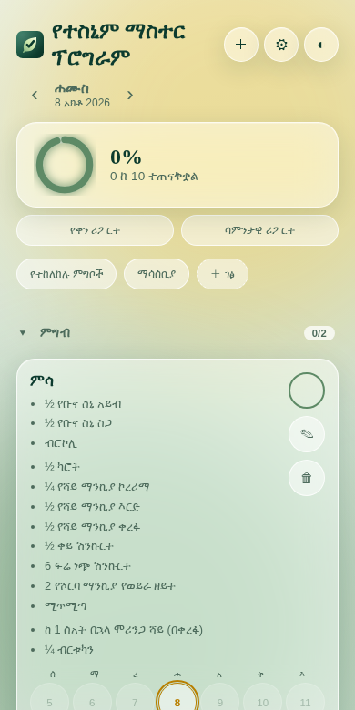
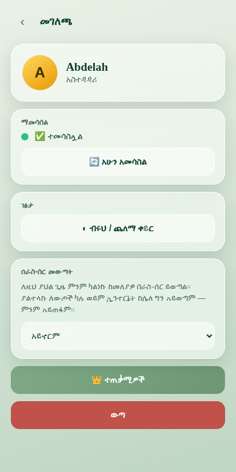

# የተስኒም ማስተር ፕሮግራም (Ye-Tesnim Master Program)

An Amharic daily-program tracker: meals, reminders and any custom activity, ticked day by day,
with percentage reports, streaks, notes, user accounts with roles, and cloud sync that keeps working offline.

| Main list (grouped by category) | Profile page | Category manager |
|---|---|---|
|  |  |  |

> **In one sentence:** a static website (plain JavaScript, built with Vite) that talks to a Supabase
> database for login and sync, and that installs on a phone like an app.

---

## Contents

1. [What it does](#1-what-it-does)
2. [Roles and permissions](#2-roles-and-permissions)
3. [How a day is counted (the rules)](#3-how-a-day-is-counted-the-rules)
4. [How sync and offline mode work](#4-how-sync-and-offline-mode-work)
5. [Architecture](#5-architecture)
6. [Tech stack](#6-tech-stack)
7. [Folder structure](#7-folder-structure)
8. [Run it on your computer](#8-run-it-on-your-computer)
9. [Supabase setup](#9-supabase-setup)
10. [Deploy (Netlify / Vercel)](#10-deploy-netlify--vercel)
11. [Data model](#11-data-model)
12. [Security notes](#12-security-notes)
13. [Troubleshooting](#13-troubleshooting)
14. [Where to edit things](#14-where-to-edit-things)
15. [Roadmap](#15-roadmap)

---

## 1. What it does

**For everyone who logs in**

- Shows the activities of **today's weekday** and lets you mark each one:
  **✓ done**, **✗ not done**, or **a percentage** (for example 60%). One tap on the circle gives ✓;
  tap **ውጤት** (result) to pick ✗ or a percentage.
- **Master activities** have sub-items. When every sub-item is ticked, the master becomes ✓ by itself.
- **Notes** (📝): write a short note on any activity for any day you may edit. A note never changes the result.
- The main list is **grouped by category** (for example "ምግብ" and "ማሳሰቢያ"). Each group header shows
  `done/total` and a fold arrow; the fold is remembered on your phone.
- Every card has a **week strip** (Mon–Sun), its **streak**, this week's %, and shortcuts to its
  **Calendar** and **Statistics**.
- **Day report** and **weekly report**: today's %, streak, what is left, a 7-day bar chart, and a "needs attention" list.
- **◔ Dashboard** (tap the ring card): **Day / Week / Month** tabs and a date picker. It is computed **on the server**, so
  everyone sees the same **Overall %**. A member who only sees some activities also gets **My part**; for everything else
  the server sends only a percent — never names or counts. The last answers are saved on the phone, so it opens offline
  (marked "📴 saved copy"). Tap a day in the week or month view to open that day.
- **Reference pages** (prohibited foods, notices and any page you add) — read-only for members.
- **Profile page** (tap the round avatar, top right): your name and role, sync status, **storage on this phone** (where, how much,
  any save error), theme (light / dark),
  automatic logout, and **Logout** (two taps, so it can't happen by accident).
- **Sync dot on the avatar:** 🟢 synced · 🟡 with a number = that many ticks are waiting to be sent · ⚪ offline.
- Installable on Android / iPhone ("Add to Home Screen") and works with no internet after the first sync.

**Extra for admins and editors** (see the permission table)

- **＋ Add** an activity: category → type (single or master) → name → description → weekdays.
- **✎ quick edit** (name + description, "today only" or "every time", and the category — always "every time").
- **Edit tab** in an activity's detail page: category, type, sub-items, name, description, weekdays, delete.
- **🏷 Categories** (⚙ Settings): rename a whole category, merge two, or delete one (its activities move to another category
  or to "no category" — nothing is ever deleted).
- **🗑 Recycle Bin** (⚙ Settings): every deleted activity or page stays here until restored or deleted forever.
- **📤 / 📥 Backup** export and import (admin only).
- **📦 Import built-ins** (admin, ⚙ Settings): adds the meals, reminders and pages of `src/data.js` to the server's list, and refreshes
  the ones nobody has edited. Since Bundle C they no longer auto-sync on every phone; a brand-new empty server gets them once automatically.
- **Dashboard start day** (admin, bottom of the Dashboard): "count from this day" shows a separate "since …" result; nothing is deleted.
- **👑 Users** (admin, from the profile page): create users, choose a role, and choose which activities each user sees.
  The list is grouped by category, and one switch on a group assigns all of its activities.
- **Daily reminder** at 8 AM — fires only while the app is open (a closed-app push needs a server; see the roadmap).

---

## 2. Roles and permissions

An **admin** can do everything. Everyone else gets a **role**, which is just a ready-made set of permissions.
You can still tick permissions one by one ("custom").

| Permission | Meaning |
|---|---|
| `tick` | ✓ mark activities (today) |
| `past` | change **past** days (never future days) |
| `dash` | see the result ring and the ◔ Dashboard |
| `rep` | day and weekly reports |
| `stat` | Statistics tab |
| `cal` | Calendar tab |
| `add` | ＋ add activities and pages |
| `edit` | ✎ edit activities, pages and categories |
| `del` | 🗑 delete. **Off = the person cannot delete anything**: activities, pages, whole categories, deleting forever from the Recycle Bin, emptying it, and backup import. The buttons are hidden **and the server refuses** such a save (restoring, renaming and editing still work). |
| `trash` | ♻ Recycle Bin |
| `set` | ⚙ Settings (reminder etc.) |

| Role | Permissions it switches on | Sees which activities |
|---|---|---|
| 👤 **Member** | `tick dash rep stat cal` | only the ones the admin assigned |
| 👁 **Viewer** | `dash rep stat cal` | only the ones assigned |
| 🕘 **History editor** | `tick past dash rep stat cal` | only the ones assigned |
| ✎ **Editor** | `add edit del trash dash rep set stat cal tick` | all |
| ⚙ **Custom** | whatever you tick | assigned, or all |
| 👑 **Admin** | everything, including Users and Backup | all |

**Login speed limit:** 5 wrong passwords for one user name within an hour → that name must wait 30 seconds, then 1, 2, 4, 8 minutes,
at most 15. 20 wrong passwords from one internet address → that address waits the same way. The login screen counts down.
A correct password clears the count.

**Day lock:** everyone edits only **today**. Past days need `past`. Future days are never editable.
The server is also asked to enforce it: if it refuses a tick, the app shows
"⛔ this day is locked" and reloads the true copy.

---

## 3. How a day is counted (the rules)

One rule is used everywhere — the list, the ring, the reports, the streaks, the calendar and the statistics:

> An activity counts on a day only if **(1)** its weekdays *on that day* include that weekday, **(2)** that day is on or after the day it
> was created (a real tick or note on an earlier day is never hidden), and **(3)** it was not in the Recycle Bin that day.

What this means in practice:

- **Adding** an activity today does not change yesterday, and it can't reset your streak.
- **Deleting** one keeps it counting on the days *before* the deletion (shown greyed-out on those days as "🗑 ተሰርዟል").
  Restoring it does not make the days it spent in the bin count.
- **Changing the weekdays**, **adding or removing a sub-item**, or **switching single ↔ master** takes effect **from today**;
  days already over keep the shape they had.
- Only **deleting forever** from the Recycle Bin erases an activity's past results.

**Scoring:** ✓ = 100, a percentage = that number, ✗ or untouched = 0. A day's % is the average over that day's activities.
The **streak** counts consecutive days where *every* activity was ✓; an unfinished *today* does not break it.

---

## 4. How sync and offline mode work

- Every change is saved on the phone first, in **IndexedDB** (the browser's large storage; the tick history is kept **one record per
  month**), then sent to the server about a second later. Ticks not yet sent wait in a small **outbox** — there is no second full copy.
- While the app is on screen it checks the server **once a minute**. With `supabase/30_c_sync.sql` installed it asks `app_sync`
  for **only what changed** (the lists only if they changed, only the months of ticks that changed — a few hundred bytes when
  nothing changed). Without it, the app uses `app_get` (everything) as before.
- **Changes by other people appear in place** — no page reload. If a dialog or edit page is open, they wait until it closes.
- **Ticks are merged, never overwritten:** the app sends only the ticks *this* phone changed, so two people ticking at once don't erase each other.
- **Offline:** the app opens from the saved copy and keeps counting your ticks. They are sent automatically when the internet returns
  (the avatar shows 🟡 + the number meanwhile).
- **Saving can fail** (phone storage full): the app says so, shows it on the profile page, keeps the change in memory and retries every
  15 seconds. If IndexedDB is not available at all (some private windows), it uses `localStorage` instead.
- **Logout never throws away unsent ticks:** it tries to send them first and warns you if it can't. After logout, nothing of that
  user stays on the phone.
- **Automatic logout** (profile page, off by default) only fires when the phone is online and nothing is waiting to be sent.
- The very **first login needs internet** (the phone must get your data once). Without it the app says "ኢንተርኔት ያስፈልጋል".
  After one successful sync, it opens offline.
- A **service worker** (`public/sw.js`) asks the network first for the page, so a new version always reaches the phone; if the network
  is missing or slower than 3 seconds it uses the saved copy. Build files (`assets/…`) are answered from the phone. Files of old
  versions are removed after 14 days without use. It works at a domain root or inside a sub-folder.
- The **Amharic font** (Noto Sans Ethiopic, 55 KB, only the Ethiopic letters) is part of the app, so Amharic looks the same on every
  phone, also offline.

---

## 5. Architecture

```
 Phone / browser                                                    Supabase (cloud)
 ┌────────────────────────────────────────────────────┐             ┌───────────────────────┐
 │ index.html     – page shell and all dialogs         │             │ Postgres database      │
 │ src/boot.js    – starts everything, in this order:  │             │ + SQL functions (RPC)  │
 │   1 src/store.js – IndexedDB (history by month,     │             │   app_login (limit)    │
 │                    outbox of unsent ticks, events)  │  HTTPS      │   app_sync (changes)   │
 │   2 src/sync.js  – login, sync, roles, profile,     │ ──────────► │   app_get              │
 │                    user admin  (src/config.js)      │  /rest/v1/  │   app_put (del lock)   │
 │   3 src/main.js  – the app (lists, reports, edits)  │  rpc/…      │   app_put_log          │
 │ src/data.js    – built-in meals, reminders, pages   │ ◄────────── │   admin_list/save/del  │
 │ public/sw.js   – offline copy of the app            │             │   app_dash (dashboard) │
 └────────────────────────────────────────────────────┘             └───────────────────────┘
```

- `boot.js` opens the store, logs in and fetches what changed, and only then starts `main.js` — so the app always starts with
  complete data and never needs a reload to apply it.
- `main.js` reads and writes through `store.js`. Every change sends an event; `sync.js` listens and sends it to the server.
  Server changes go into the store and send a `remote` event; `main.js` redraws.
- There is no framework and no build-time secret: the built site is plain static files.

---

## 6. Tech stack

- **Front end:** vanilla JavaScript (ES modules), plain CSS (glassmorphism, light/dark), no framework.
- **Build:** [Vite](https://vitejs.dev) 5.
- **Backend:** [Supabase](https://supabase.com) (Postgres) called through SQL functions over REST (RPC).
- **Hosting:** any static host — Netlify (primary) and Vercel (backup).
- **Phone install:** web app manifest + service worker (PWA).

---

## 7. Folder structure

```
tesnim-master-program/
├── index.html                 # page shell, dialogs, category manager and detail views (markup)
├── package.json               # scripts: dev, build, preview
├── vite.config.js             # base './' so the build works at any path
├── netlify.toml               # Netlify: build "npm run build", publish "dist"
├── .gitignore                 # node_modules, dist, .env
├── README.md
├── docs/
│   └── screenshots/           # images used by this README
├── supabase/                  # SQL to paste into Supabase > SQL Editor (not part of the website build) - see supabase/README.md
│   ├── 00_audit.sql           # read-only look at the database
│   ├── 10_ / 11_ / 12_ / 19_  # B1: Dashboard engine (tables, functions, self-test, undo)
│   ├── 20_ / 29_              # B2: delete lock + login speed limit (with self-test), and its undo
│   └── 30_ / 39_              # C: app_sync "send only what changed" (with self-test), and its undo
├── public/                    # copied as-is into the build
│   ├── sw.js                  # offline service worker (page: network first, 3 s fallback; build files: from the phone)
│   ├── manifest.webmanifest   # "Add to Home Screen"
│   ├── favicon.svg / favicon.ico / apple-touch-icon.png
│   └── icon-192.png / icon-512.png / icon-maskable-512.png
└── src/
    ├── boot.js                # first file: opens storage, logs in / syncs, then starts main.js
    ├── config.js              # THE TWO LINES TO EDIT: Supabase URL and public key
    ├── store.js               # data on the phone: IndexedDB, history by month, unsent-ticks outbox, events, errors
    ├── sync.js                # login, sync, roles, profile page, user admin (was public/cloud.js)
    ├── main.js                # the app: counting rules, list, reports, editing, categories, recycle bin, backup, dashboard
    ├── data.js                # built-in meals, daily reminders and reference pages (imported by the admin: ⚙ → 📦)
    ├── style.css              # colours, layout, all components
    ├── noto-sans-ethiopic-subset.woff   # Amharic font (Ethiopic letters only, 55 KB) — works offline
    └── OFL-NotoSansEthiopic.txt         # the font's licence (SIL Open Font License)
```

---

## 8. Run it on your computer

Needs [Node.js](https://nodejs.org) 18 or newer.

```bash
npm install
npm run dev        # opens http://localhost:5173
npm run build      # makes the static site in dist/
npm run preview    # test the built site
```

`npm run dev` is free and does not touch Netlify — use it to test before you push.

---

## 9. Supabase setup

**The two lines to edit** are in `src/config.js`:

```js
export const SB_URL = 'https://YOUR-PROJECT.supabase.co';
export const SB_KEY = 'YOUR-ANON-PUBLIC-KEY';
```

Find them in Supabase → **Project Settings → API** (the *Project URL* and the *anon public* key).
If `SB_URL` still starts with `YOUR-`, the app runs in plain local mode with no login.

**The database functions.** The app calls these SQL functions (RPC):

| Function | Used for |
|---|---|
| `app_login(p_user, p_pass)` | log in, returns a session `token` — or `{error:'bad'}` / `{error:'slow', wait}` (B2 speed limit) |
| `app_get(p_tok)` | everything this user may see: `user`, `shared`, `mine`, `log`, version numbers |
| `app_sync(p_tok, p_sv, p_mv, p_lv, p_months)` | Bundle C: the same as `app_get`, but only the parts that changed (`supabase/30_c_sync.sql`) |
| `app_put(p_tok, p_shared, p_mine)` | save shared data (programs, pages, trash…) and the user's own settings; refuses `nodelete:…` when 🗑 is off (B2) |
| `app_put_log(p_tok, p_changes)` | save ticks (only the changed ones; returns the ones it refused) |
| `admin_list(p_tok)` | admin: list users |
| `admin_save(p_tok, p_id, p_username, p_pass, p_admin, p_perms, p_programs)` | admin: create / edit a user |
| `admin_delete(p_tok, p_id)` | admin: delete a user |
| `app_dash(p_tok, p_from, p_to, p_wd, p_dates)` | the Dashboard numbers (B1 engine, `supabase/11_dash_functions.sql`) |
| `app_dash_restart(p_tok, p_start, p_clear)` | admin: set / remove the Dashboard start day |

The Dashboard engine (B1) and the delete lock + login limit (B2) are in the `supabase/` folder — see `supabase/README.md` for the order.

> ⚠ The **original** tables and functions (`app_users`, `app_shared`, `app_log`, `app_login`, `app_get`, `app_put`, `admin_*` …) still
> exist only inside the Supabase project, so a brand-new Supabase project cannot yet be set up from this repo alone.
> B2 did not need their code: it renamed the old `app_put` / `app_login` to `_app_put_core` / `_app_login_core` and put a checking
> function with the same name in front of each.

---

## 10. Deploy (Netlify / Vercel)

**Netlify**

1. Push the project to GitHub.
2. Netlify → **Add new site → Import an existing project** → pick the repository.
3. `netlify.toml` already sets the build command (`npm run build`) and the publish folder (`dist`). Click **Deploy**.
4. Every push to the connected branch deploys automatically.

Tip: each production deploy uses build minutes/credits on your plan. Test locally with `npm run dev`, and push to a **branch** (previews)
and merge to the main branch only when a set of changes is finished.

**Vercel** — import the repository; Vite is detected automatically (`npm run build`, output `dist`).

No environment variables are needed: the Supabase URL and public key are the two lines in `src/config.js`.
Deploy at the **root of a domain** (both hosts do this by default).

---

## 11. Data model

On the phone everything lives in **IndexedDB** (database `tesnim`: store `kv` for the values below, store `months` with one record
per month of ticks), and shared data also on the server. Only small per-phone settings stay in `localStorage`.

**Activity** (`tesnim_programs` is an array of these)

```js
{
  id, name, desc,
  category: 'ምግብ',                    // the category name (text, shared by all its activities)
  type: 'simple' | 'checklist',        // single ✓  |  master with sub-items
  subItems: [{ id, name }],            // masters only
  schedule: 'daily' | [1..7],          // 1 = Monday … 7 = Sunday
  seed: true|false,                    // came from data.js
  customized: true|false,              // edited by a person (then data.js stops refreshing its text)
  createdAt: '2026-10-04',             // the first day it counts
  // history helpers, added automatically:
  catSet: true,                        // the category was chosen by a person (data.js must not undo it)
  sh: [{ u, s }],                      // weekdays it had before day u
  vh: [{ u, t, s }],                   // type / sub-items it had before day u
  off: [[from, to]]                    // days it spent in the Recycle Bin before being restored
}
```

**Results** (`tesnim_log`): `log['2026-10-04'][activityId]` is one of

```js
true                              // ✓ done
{ r: 'x' }                        // ✗ not done
{ r: 'p', p: 60 }                 // 60 %
{ subId1: true, subId2: true }    // a master's sub-ticks
{ …any of the above, n: 'text' }  // plus a note
```

**Other values in IndexedDB:** `tesnim_pages`, `tesnim_trash` (Recycle Bin), `tesnim_removed_seeds`, `tesnim_dayov` ("today only" edits),
`tesnim_first` (first day used), and — written by `sync.js` — `tesnim_me`, `tesnim_role`, `_sync` (versions + month fingerprints),
`_dirty`, `_outbox` (unsent ticks), `_synced`, `_v`.

**In localStorage (small, per phone):** `tesnim_token`, `tesnim_theme`, `tesnim_reminder`, `tesnim_catfold` (folded groups),
`tesnim_autologout`, `tesnim_dash` (saved Dashboard answers).

**Upgrading from an older version:** on the first start the old `localStorage` data is moved into IndexedDB once (unsent ticks
included) and then removed from `localStorage`.

**Categories** are not a separate table: a category is the name written on its activities. Two spellings that differ only by
spaces or capital letters ("ምግብ" and "ምግብ ") are treated as one, and everything that saves a category goes through one function
so a duplicate can't be created again.

---

## 12. Security notes

- The Supabase **anon key is public by design** (it is in the website's code). **All protection must live in the SQL functions on the server.**
  Because that SQL is not in this repo, it cannot be reviewed here.
- The built-in meals and reminders in `src/data.js` are part of the **public JavaScript** — anyone who opens the site's files can read them.
  Hiding an activity from a member hides it in the app, not from someone inspecting the files. Put anything private in activities you add
  inside the app, not in `data.js`.
- The **Dashboard** is computed on the server; a restricted member receives only percents for activities that are not theirs.
- **Delete lock** (B2): when 🗑 is off for a user, the server itself refuses any save that would remove an activity, a page, a whole
  category or a Recycle Bin entry (restoring is allowed). Admins are never locked. Notes and un-ticking are not treated as deleting.
- **Login speed limit** (B2): see section 2. A locked-out admin can clear it in the SQL Editor with `delete from app_login_fails;`.
- Sessions expire after 90 days (in `_me`). Both password boxes hide what is typed.
- **Use 📤 Backup regularly.** Clearing the browser's data on a phone removes its local copy (the server copy remains).

---

## 13. Troubleshooting

| Problem | What to check |
|---|---|
| Login says "connection failed" | Is the phone online? Are `SB_URL` / `SB_KEY` in `src/config.js` correct? |
| "ስሙ ወይም የይለፍ ቃሉ ትክክል አይደለም" | Wrong user name or password. |
| "ኢንተርኔት ያስፈልጋል" on a new phone | The very first login needs internet. Sign in once, wait for 🟢, then it opens offline. |
| "⚠ … ማስቀመጥ አልተሳካም" | The phone could not save (storage full). Profile → Storage shows the error; free some space. Nothing is lost while the app stays open; it retries every 15 s. |
| Ticks stay 🟡 | They are waiting for internet; they are sent automatically. Profile → "🔄 አሁን አመሳስል" forces a try. |
| "⛔ ይህ ቀን ተቆልፏል" | You tried to change a past or future day without the `past` permission. |
| "⛔ መሰረዝ አልተፈቀደልዎትም" | 🗑 is off for this user, so the server refused a save that would delete something. The phone reloads the true copy. |
| "⏳ … ከ N ሰከንድ በኋላ" at login | Too many wrong passwords. Wait, or (admin) run `delete from app_login_fails;` in the SQL Editor. |
| Dashboard says "📴 … የተቀመጠ ቅጂም የለም" | No internet and that period was never opened on this phone. Open it once online. |
| An old version keeps showing | Close and reopen the app once (the service worker asks the network first). |
| Built-in meals missing on a new server | Admin: ⚙ Settings → 📦 import built-ins. |
| `npm run build` fails | Use Node 18+, run `npm install` first. |

---

## 14. Where to edit things

- **Built-in meal / reminder / page text** → `src/data.js`, then (admin) ⚙ Settings → 📦 import. Items nobody has edited get the new text.
- **Colours** → the `:root { … }` block at the top of `src/style.css`.
- **App name, logo, tab title** → `index.html` (marked with comments).
- **Supabase URL and key** → `src/config.js`.
- **Roles and permission names** → `ROLES` and `PERMS` near the top of `src/sync.js`.

---

## 15. Roadmap

**Done in Bundle B:** server-computed Dashboard (B1 engine + B2 page), delete lock enforced on the server, login speed limit.

**Next (needs the server):** export the original tables and functions into `/supabase`; filter tick logs and notes per user on the
server; real category objects (colour, order) so assigning a category can also cover activities added later; automatic backups and a
keep-alive (free Supabase projects pause after a week without use).

**Done in Bundle C:** IndexedDB storage with the history by month and an outbox instead of a second copy; `app_sync` sends only what
changed; the Ethiopic font is bundled; the service worker works in sub-folders and cleans old files; one data layer with events — no
patching of `localStorage.setItem`, no reloads; built-ins come from the server only.

**Not done yet (on purpose):** voice notes in Supabase Storage (needs the voice-note feature first); folding very old months into
summaries (not needed until there are several years of history — the month split already keeps saving fast).

**Later:** real push reminders (Web Push), fingerprint unlock, unit tests for the counting and sync logic, and splitting `main.js` into modules.
